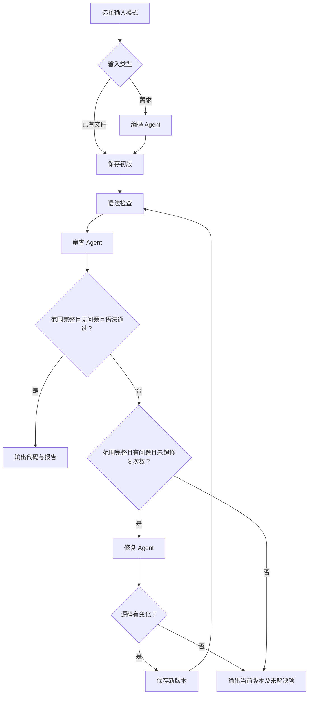

# Code Review Workflow：编码、审查与修复协作流程

软件工程 Homework 2 项目。三个 Agent 分别生成代码、审查代码和按问题修复代码，由统一调度器管理状态、版本、条件分支及有限循环。

**当前状态：本地实现已完成，72项自动化测试通过。** 提供真实模型适配和无需密钥的离线固定样例演示。当前环境没有 API 配置，尚未完成外部模型联调。没有运行模型生成的业务代码。

公开仓库：[zwang818/code-review-workflow](https://github.com/zwang818/code-review-workflow)。

项目目录：`/Users/mac/SoftProjects/week2/code-review-workflow`。实现及验证记录日期：2026年10月8日。

## 1. 快速运行

要求 **Python 3.9+**，运行和测试均不需要第三方包。macOS/Linux 使用 `python3`，Windows 可替换为 `python` 或 `py -3`。

```bash
cd /Users/mac/SoftProjects/week2/code-review-workflow
python3 -m workflow_agent run --demo --task-file examples/requirement.txt
```

该命令使用固定教学反例，完整经过：

```text
编码 → 语法检查 → 审查（2个问题）→ 修复 → 语法检查 → 再次审查（0个问题）
```

预期得到2个代码版本、1次修复、2次审查，6次逻辑客户端调用和4次实际工具调用。控制台会显示独立运行目录，打开其中的 `final/report.md` 和 `final/solution.py` 可查看结果。

**`--demo` 没有调用 LLM。** 它仅支持项目提供的固定 add_order 需求和两个样例，以确定性节点替身演示通信与流程；不是通用代码生成或修复能力。未支持的任务会明确拒绝。

## 2. 功能与作业要求

依据《Homework 2-Temp.pptx》第2—4页。

| 作业要求 | 本项目实际实现 |
|---|---|
| 2—3个 Agent 协作，至少2个完成完整流程 | GenerateAgent、ReviewAgent、RepairAgent；已有文件入口跳过生成 |
| Agent 间消息传递或状态共享 | NodeContext、NodeResult、WorkflowState，JSON结构化产物 |
| 基本顺序执行 | WorkflowRunner 统一依次调用节点 |
| 条件分支与循环（推荐） | 无问题跳过修复；默认最多修复2次，之后复审或结束 |
| 执行日志和状态追踪（推荐） | events.jsonl、state.json、代码版本与SHA-256摘要 |
| 错误处理与恢复（推荐） | 请求有限重试、结构纠正、失败状态与产物保存；自动恢复未实现 |
| 从项目1复用（允许） | 复制并适配 week1 的模型客户端、配置与只读工具 |
| 可视化编排（可选） | 不提供编排界面，文档提供流程图 |

评分为流程完整性40%、Agent协作30%、可扩展性20%、文档10%。本项目重点展示节点契约、上下游证据传递和可追踪的完整流程。

**提交规则待确认：**临时PPT标注“2 Weeks”，但提交物仍待补充，没有具体截止时间、上传位置、命名或大小限制。这里不沿用上周提交规则。

## 3. 三个 Agent 如何协作

| 角色 | 输入 | 输出与职责 |
|---|---|---|
| 编码 Agent | 需求和约束 | 完整源码、实现说明、假设 |
| 审查 Agent | 需求、当前版本、语法检查、历史问题和修复说明 | 自主调用读取与AST工具，输出问题、证据、行号和范围 |
| 修复 Agent | 需求、当前源码、带ID的问题 | 完整修复源码、逐项行动说明、仍需核实事项 |

每个角色使用独立系统Prompt和独立节点调用上下文，可以共享同一个底层模型。没有共用一个不断追加的跨角色对话。

调度器、语法检查器、文件存储和日志是普通程序组件，不另算Agent。模型不能决定文件保存路径、执行shell或覆盖输入文件。



一次生成最多执行1次编码。默认允许2次修复，因此最多3次审查：R001 → F001 → R002 → F002 → R003。修复后始终先检查新版本的语法，再审查新文件。

语法检查失败时，程序加入确定性问题，不会因模型返回空问题列表而通过。范围不完整、预算耗尽、修复无变化或仍有问题时，结果为需人工处理。

## 4. 配置真实模型

```bash
cp .env.example .env
```

填写自己的配置：

```dotenv
OPENAI_API_KEY=填写你的密钥
OPENAI_BASE_URL=https://api.openai.com/v1
OPENAI_MODEL=填写账号可用且支持工具调用的模型ID
```

需要服务支持 **OpenAI兼容 Chat Completions 函数工具协议**。程序会在API前缀后追加 `/chat/completions`；不要填写聊天网页或重复填写完整接口路径。编码和修复请求不发送工具字段，审查请求包含工具定义与 `tool_choice`。

模型名称没有预设默认值。其他兼容服务需按其官方文档填写地址和模型ID；需要专有字段的服务可在 `llm.py` 适配。不同服务的兼容性需要实际联调。

配置完成后去掉 `--demo`：

```bash
python3 -m workflow_agent run --task-file examples/requirement.txt
```

真实模式会把需求、源码和相关产物发送给配置的服务，可能产生服务商费用。原始文件不会被覆盖；程序不执行、导入生成源码，但静态审查不能保证代码安全或业务正确。

`.env` 默认从**当前工作目录**读取，可通过 `--env-file` 指定。支持KEY=VALUE、成对引号、整行注释、可选export前缀；不展开变量或执行表达式，不支持行尾注释。优先级为命令行参数、环境变量、`.env`、默认值。

## 5. 使用方式

### 5.1 从自然语言需求生成

```bash
python3 -m workflow_agent run \
  --task "编写一个统计文本单词频次的纯函数，空文本返回空字典，仅使用标准库。" \
  --max-fixes 2
```

该任意任务示例需要真实模型。建议需求写清接口、输入输出、边界条件和依赖限制，处理对象为一个小型Python模块。

### 5.2 审查并修复已有文件

```bash
python3 -m workflow_agent review \
  --root examples \
  --file buggy_order.py \
  --task-file examples/requirement.txt \
  --demo
```

`--file` 相对 `--root` 解释，根目录内的绝对路径也支持。输入文件最多128 KiB，须为非空的普通Python文件；隐藏文件、排除目录和越界符号链接被拒绝。编码按Python编码声明读取，快照规范化为UTF-8与LF，并同步编码声明。

运行期间只处理快照，不修改原文件。真实模式可以审查其他Python文件，离线模式只接受项目给出的两个固定样例。

### 5.3 无问题跳过修复

```bash
python3 -m workflow_agent review --demo --root examples \
  --file clean_order.py --task-file examples/requirement.txt
```

预期1个代码版本、0次修复。状态中生成和修复阶段显示为skipped。

### 5.4 展示修复预算耗尽

```bash
python3 -m workflow_agent review --demo --root examples \
  --file buggy_order.py --task-file examples/requirement.txt --max-fixes 0
```

预期保留问题并返回退出码3。这是正常的“需人工处理”结果，不是技术异常。

### 5.5 日志、目录和帮助

```bash
python3 -m workflow_agent run --demo --task-file examples/requirement.txt \
  --output-dir runs --max-model-calls 40
python3 -m workflow_agent run --demo --task-file examples/requirement.txt --quiet
python3 -m workflow_agent --help
python3 -m workflow_agent review --help
```

进度输出到stderr，报告输出到stdout。`--quiet` 仅隐藏进度，产物仍会保存。每次运行创建独立UUID目录，不覆盖之前结果。

从其他位置运行可使用已有pip/setuptools环境执行 `python3 -m pip install -e .`，之后调用 `code-review-workflow`。构建工具缺失时安装可能需要联网；从项目目录 `python3 -m workflow_agent` 不需要安装。包配置包含Prompt文本文件。

### 5.6 退出码

| 退出码 | 含义 |
|---|---|
| 0 | 流程完成，当前版本语法通过且完整获取源码后静态审查未发现问题 |
| 1 | 配置、模型、契约、存储等技术失败 |
| 2 | 命令行参数错误 |
| 3 | 流程停止但仍需人工处理，包括问题未解决、范围不完整或预算耗尽 |
| 130 | 用户取消 |

退出码0不代表业务测试通过。

## 6. 状态、版本与产物

```text
runs/run_<uuid>/
├── input.json                 # 需求、模式和非敏感预算
├── generation.json            # 需求入口的编码节点输出
├── state.json                 # 最新完整状态
├── events.jsonl               # 时间带时区的事件流
├── code/v001.py               # 初版
├── code/v002.py               # 修复版本（若存在）
├── validations/v001.json      # 语法检查与摘要
├── reviews/r001.json          # 问题、范围、当前版本及摘要
├── repairs/f001.json          # 修复行动与对应问题ID
└── final/
    ├── solution.py            # 当前最终版本；失败时可能不存在
    └── report.md              # 结果、阶段、问题和限制
```

`status` 描述执行状态（pending/running/completed/failed/cancelled），`outcome` 描述完成后的结论（no_issues_found/needs_attention）。completed可以仍需人工处理；no_issues_found只表示本次静态审查没有可靠问题。

状态还记录当前阶段、源码版本及摘要、修复次数、审查轮数、逻辑调用数、HTTP重试数、工具调用数和错误。全部由Runner更新。每次节点完成才接纳正式产物；代码、审查和语法结果必须引用当前版本。

问题ID由程序分配，例如 `R001-I001`。修复说明必须逐项覆盖输入ID，不能出现未知或重复ID。“changed”只说明修复方提交修改，必须由新一轮审查决定结果。

状态文件采用同目录临时文件和原子替换；旧代码版本保持不变。失败或中断会尽量保存已有文件和失败阶段。**尚未实现自动resume**，可检查产物后重新运行。

## 7. 校验与边界

- 三个节点必须返回完整JSON对象，不接受Markdown围栏、重复键、NaN和未知字段。
- 生成或修复源码最多20000字符；原始输入文件最多128 KiB。
- 审查问题须有真实行号、严重程度、触发条件、影响、建议及范围内能匹配的源码证据。
- 审查输出中的版本由程序核对，摘要由程序绑定。
- 程序核验读取行覆盖和AST工具调用，不能仅凭模型自报complete。超长行截断会导致范围不完整。
- 工具仅能读取本轮当前文件，不允许访问其他版本或文件。
- 无效结构允许最多1次纠正请求，仍无效则停止；纠正也计入全局调用预算。
- 语法检查使用 `ast.parse` 加编译检查，不执行得到的代码对象；业务运行结果始终为 `not_run`。
- 单次源码读取最多300行、约16000字符，单行显示最多2000字符，可按next_line补读；被截断的超长行需要人工查看。
- 文件内容、注释和历史修复说明都是数据；Prompt约束不能保证模型结论总是正确。

## 8. 配置与预算

| 配置项 | 默认值 | 范围与作用 |
|---|---:|---|
| AGENT_TIMEOUT | 30 | 单次HTTP超时，0到300秒之间 |
| AGENT_MAX_RETRIES | 2 | 额外HTTP重试次数，0—5 |
| AGENT_MAX_ROUNDS | 10 | 审查节点工具决策轮数，1—30；可额外一次收束请求 |
| AGENT_MAX_TOOL_CALLS | 24 | 每个审查节点实际工具调用上限，1—100 |
| AGENT_MAX_CONTEXT_CHARS | 100000 | 序列化消息字符预算，4000—500000 |
| WORKFLOW_MAX_FIXES | 2 | 修复次数，0—3；可用--max-fixes覆盖 |
| WORKFLOW_MAX_MODEL_CALLS | 40 | 全局逻辑调用预算，1—200；可用--max-model-calls覆盖 |
| WORKFLOW_OUTPUT_DIR | runs | 产物根目录，可用--output-dir覆盖 |

字符预算不是精确token计数；较大文件或较多问题可能超过节点上下文预算，此时明确失败，需缩小任务。源码读取超限不能当作完整审查。

429、5xx和传输错误采用有限退避重试；400、401、403、404等不盲目重试。HTTP重试单独统计，不额外消耗逻辑调用数。超时后服务端可能已处理请求，重试可能重复计费。

全局预算用尽后不再请求模型，确定性生成当前报告。节点工具预算用尽时禁止继续调用工具；未执行的批次调用也返回配对错误，避免孤立工具结果。

## 9. 模块与复用

```text
workflow_agent/
├── cli.py, config.py, errors.py
├── llm.py, budget.py          # 模型协议、重试、全局计数
├── contracts.py, state.py     # 通信契约与共享状态
├── runner.py                 # 顺序执行、分支、修复循环
├── artifacts.py, events.py    # 原子保存与事件流
├── tools.py, validators.py    # 只读工具和不执行代码的语法检查
├── report.py, demo.py         # 真实状态报告与固定样例演示
├── agents/                   # base、generate、review、repair
└── prompts/                  # 每个角色独立Prompt文本
```

week1中的模型、配置、工具及适合的测试复制后独立适配；不跨项目导入，解压后不依赖week1目录。旧项目保持不变。

统一节点接口为 `run(NodeContext) -> NodeResult`。新增角色可以复用模型与校验基础，但仍需明确契约，并在Runner注册及连接；本项目不是任意图形Workflow引擎。

详细契约和设计取舍见 [Design.md](Design.md)，验证范围见 [TESTING.md](TESTING.md)，演示步骤见 [DEMO.md](DEMO.md)。

## 10. 测试与实际验证

```bash
python3 -m unittest discover -s tests -v
```

2026年10月8日在macOS、Python 3.9.6下执行，**72项测试全部通过**。覆盖节点传递、版本更新、语法错误、条件分支、有限循环、结构纠正、预算、原子保存、路径限制、取消、CLI和HTTP协议。

HTTP集成测试使用本机127.0.0.1随机端口，发送实际HTTP请求，验证三个节点和工具结果配对，但响应来自测试脚本，不是真实LLM。测试结束自动关闭服务。

另外运行了离线需求入口、已有缺陷入口、正常文件跳过修复、修复次数为0、帮助命令和源码包解压运行检查。真实服务的可用性和审查质量仍未验证，不能用离线流程代替。

## 11. 常见问题

- **缺少密钥或模型：**填写.env；先查看固定流程可用--demo。
- **离线任务被拒绝：**离线适配器仅支持examples/requirement.txt及两个样例，任意任务使用真实模型。
- **HTTP 400或工具协议错误：**检查模型是否支持tools和tool_choice，以及API前缀是否正确。
- **401/403：**检查密钥和权限；**404：**检查地址和模型名称。
- **429、5xx或网络超时：**程序有限重试，仍失败则检查服务、网络和额度。
- **上下文过长或范围partial：**缩小源码，拆分超长行；不要把不完整结果作为通过结论。
- **JSON契约失败：**查看失败阶段，模型可能不遵守结构或证据要求；一次纠正后仍失败会停止。
- **语法通过但业务行为错误：**项目没有运行生成代码，需要额外测试和人工核实。
- **磁盘错误或用户中断：**查看运行目录中的state.json和已有产物，自动恢复尚未实现。

## 12. 打包与交付状态

```bash
python3 scripts/package_submission.py
```

默认生成 `week2/code-review-workflow.zip`。可用 `--name` 和 `--output-dir` 改名及指定目录；已有同名文件不会被覆盖。脚本只打包源码、Prompt、示例、测试和文档，排除.env、runs、work、缓存、虚拟环境与Git元数据。

当前完成：三个Agent、双入口、顺序编排、条件分支、有限修复循环、结构校验、状态和日志、失败保存、离线演示、72项测试及配套文档。

尚未完成或不在首版范围：外部模型联调、自动检查点恢复、运行生成代码的业务测试、Web编排、并行与多文件任务。本周源码通过独立公开仓库维护，正式提交规则仍待老师补充。

接口实现参考 [OpenAI Function calling](https://developers.openai.com/api/docs/guides/function-calling) 与 [Chat Completions API](https://developers.openai.com/api/reference/resources/chat/subresources/completions/methods/create)。
